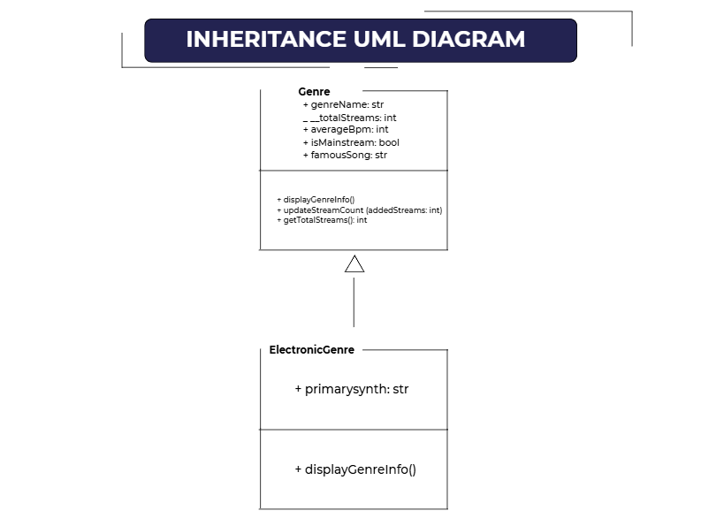
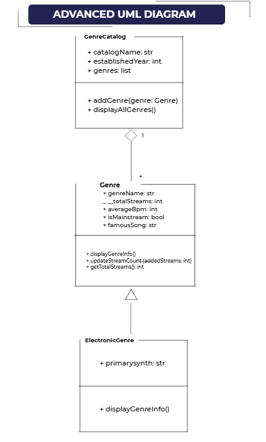
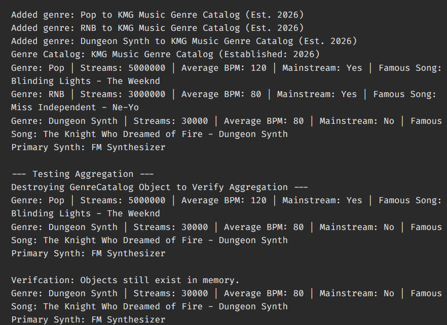
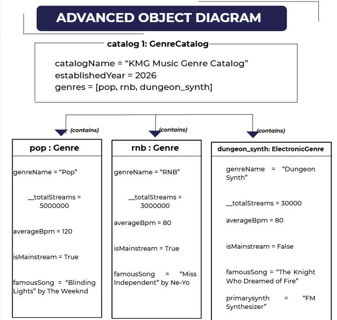

# Advanced Class Relationships

## Previous Activities
[classAttributes](classAttributesMethods.md) | [classRelationships](classRelationships.md)

## Existing Classes and Limitations

**1. Existing Classes in System**
- Class 1: Genre
- Class 2: GenreCatalog 

**2. Problems/Limitations**
The current design treats all music genres uniformly. However, specific types of genre require niche attributes. For example, electronic music explicitly depends on technical parameters like synthesizer type or certain other variations, which are irrelevant to classical or pop genres. Forcing these variables into the main Genre class makes it unnecessarily large and cluttered.

## Inheritance Relationship
**Parent:** Genre  

**Child**: ElectronicGenre  

**Explanation:** An Electronic Genre functions as a specific music Genre (IS-A Relationship). It maintains traits that are also encapsulated by the latter class such as metrics and streaming updates, but adds electronic synthesis instrumentation variables.

## Inheritance UML

## Composition / Aggregation
**Relationship:** Aggregation (Weak HAS-A)  

**Explanation:** The GenreCatalog acts as a container for individual Genre records. If the catalog container is dropped or reset, the standard music genre instances are still retained or can still exist independently.

## Advanced UML Diagram

## Python Implementation
[View Python Source Code](advancedRelationships.py)

## Test Run

## Object Diagram

## Reflection
1. Why did you choose your inheritance relationship. Explain why your child class is a type of your parent class.
- I chose ElectronicGenre as a child class of Genre because electronic music inherently shares all fundamental properties of a general music genre --- such as having a name, stream counts, average BPM, and popular songs --- while also possessing properties that are unique to it, such as synthesized music production. Because an electronic genre passes the `IS-A` test relative to a general genre, inheritance provides a model that represents this domain through the encapsulation of the same properties. Ultimately, I chose to use inheritance between `Genre` (parent) and `ElectronicGenre` (child).

2. How did inheritance reduce duplicate code? Identify attributes or methods that were reused.
- Inheritance allowed the made ElectronicGenre to reuse the attributes `genreName`,` __totalStreams`, `averageBpm`, `isMainstream`, and `famousSong'` without rewriting them. It also reused the data management methods inscribed in the previous OOP Act Activites, particularly `updateStreamCount()` and `getTotalStreams()`. In the child class, `super().displayGenreInfo()` was used to reuse the parent's print formatting instead of copy-pasting the text strings.

3. Why is your HAS-A relationship Composition or Aggregation? Explain the lifecycle relaitonship between the two objects.
- The relationship between `GenreCatalog` and `Genre` is Aggregation primarily because the objects have entirely independent lifecycles. When the catalog object is deleted using `del catalog`, the inidividual `Genre` object remains intact in memory. This proves it is a weak HAS-A relationship, which is also seen in reality as musical genres exist independently of any specific catalog tracking them.

4. What is the difference between Association fom Part III and the advanced relationship you implemented?
- The association in Part III established a connection where two classes interacted without any context of ownership or directional hierarchy. The advanced relationships implemented here introduce rules such as Inheritance, which defines a conceptual classification hierarchy between parent and child, as well as Aggregation explicitly defines a container-to-content ownership relationship. Ultimately, Part III association is a loose connection without any strict context of ownership, while Part IV Advanced Relationship defines a rigid classification as well as ownership relations.

5. How does your design follow the DRY Principle
- DRY or Don't Repeat Yourself Principle is followed in this design through the consolidation of shared logic into structural locations to eliminate redundant code blocks. General attributes and data management methods are written exactly once within the 'Genre' parent class and is inherited across sub-classes rather than being copy-pasted. Additionally, the utilization of `super().__init__()` call ensures that initialization procedures are unified so that the codebase can be kept maintainable.

