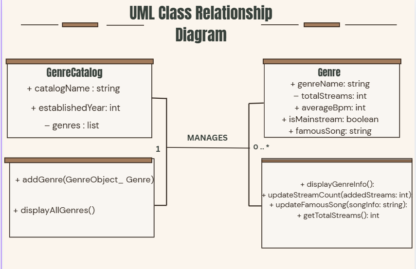
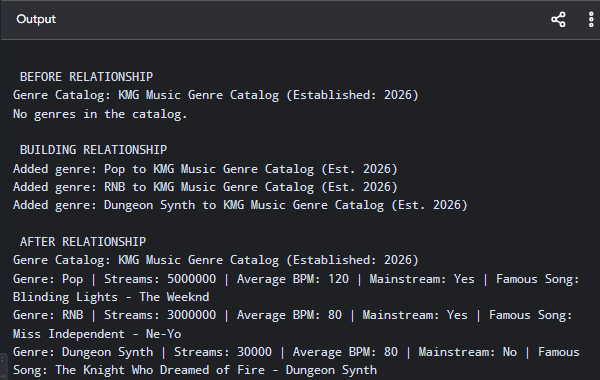
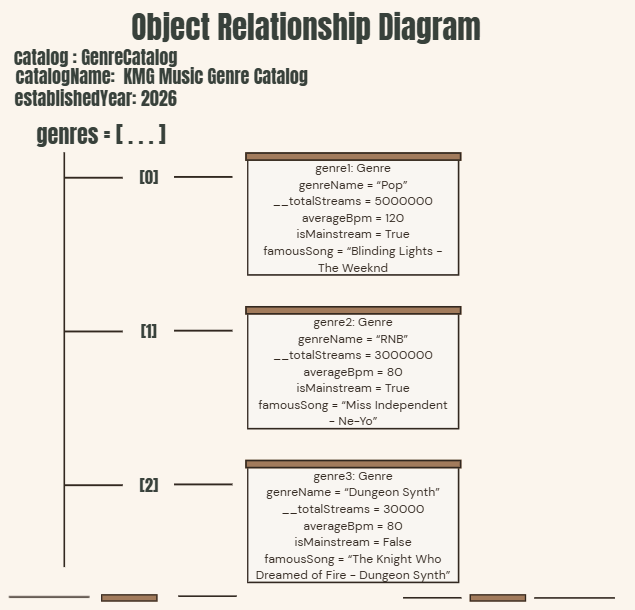

# Class Relationships: Association and Multiplicity
## Previous Work
[Part I - Classes and Objects](classObjectUML.md)

[Part II - Class Attributes and Methods](classAttributesMethods.md)

## Existing Class
Class: Genre

Description: This class represents the diversity of music, providing information on certain genres (such as name and average Bpm) and also manages global statistics and top hits under a certain genre.

# New Related Class
Class: GenreCatalog

Description: This class represents a digtal directory that organizes, oversees, and manages a collection of various music genre objects.

## Association
Relationship: GenreCatalog manages Genre
Explanation: The GenreCatalog, as the name suggests, maintains a collection of Genre references, which then helps a sreaming system aggregate data, group related musical styles together, and display comprehensive catalog overviews. 

## Multiplicity
Multiplicity: 1 : 0. .* (One-to-Many)
Explanation: A single GenreCatalog instance can contain zero or multiple Genre objects, whereas each individual Genre belongs to a specific streaming catalog system. 

## UML Class Relationship Diagram

## Python Implementation
[View Python Source](classRelationships.py)

## Test Run

## Object Rleationship Diagram

## Analysis
### What is the association between your two classes?
The association between the two classes is a management-based "HAS-A" relationship where the flesh of GenreCatalog class servres as the major crucible for multiple Genre objects. In this directory, the catalog unifies independent genres to oversee streaming statistics, data and characteristical information collectively. 

### What multiplicity did you choose and why?
I chose the one-to-many (1 : 0. . *) multiplicity because a digital music catalog needs to store and manage multiple genres simultaneously. This multiplicity fits the design primarily because the catalog itself is not restricted to a single genre, allowing it to hold anywhere from zero to many musical styles at runtime.

### How did you implement the relationship in Python?
The implementation of the aforementioned relationship was inscribed by delaring an empty list named self.genres inside the GenreCatalog constructor. Additionally, the method called addGenre() was added, and its primary function is to take a Genre objet referene as a parameter and append it directly into that list.

### Why did you store an object reference instead of copying its data?
Storing an object reference instead of copying data enables the catalog to access live methods and active attributes rather than static text strings, also, it is more efficient in terms of memory use, since a reference points to the same object in memory, so any changes made through one reference are visible anywhere else, whereas copying the data would create duplicates that could get out of sync, raising the possibility of breaking encapsulation. The object reference can also help the catalog directly invoke methods such as genre.displayGenreInfo() to read and display data.

### If your relationsip uses many, why is a list appropriate?
A list is ideal for a one-to-many relationship primarily because it can hold multiple references to related objects in an iterable structure. This makes it esier to store, access, and managae all associated objects together without having to deal with the duplication of data. A list can loop through the related items, add or remove elements, and also point to the same objects in memory. Basically, a list is appropriate for the aforementioned relationship since it provides an efficient way to work with multiple connections in a relationship.